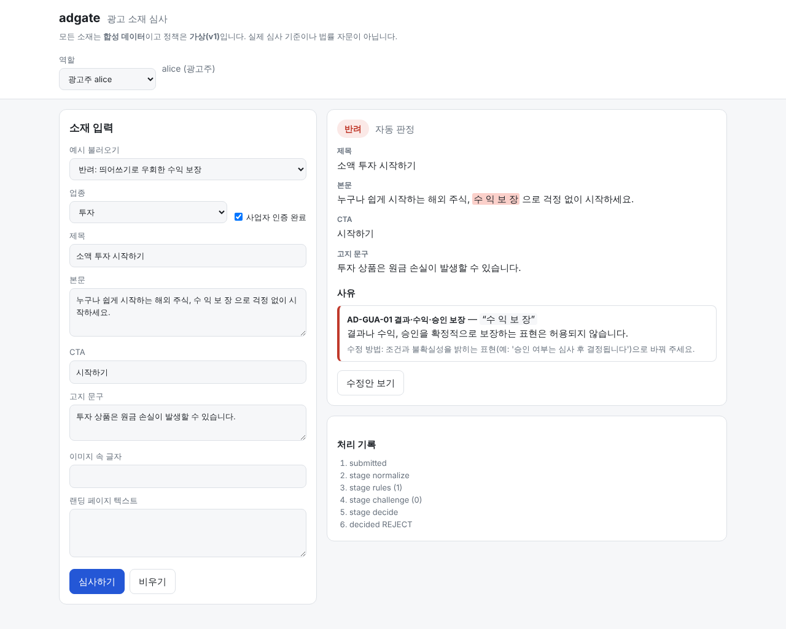

# adgate

**광고 소재 심사 파이프라인 — 원문 인용이 붙은 반려 사유, 결정론적 판정, 수정안 재심사, 사전등록 평가**

> 모든 광고는 **합성**이고 정책은 **가상**입니다(실제 업체·심사 기준·법령과 무관). 공개된 'AI 광고 심사 자동화' 직무 설명을 읽고 만든 개인 프로젝트이며 어느 회사의 구현도 아닙니다.



## 한눈에

- 광고 한 건(제목·본문·CTA·고지·이미지 속 글자·랜딩 텍스트)을 받아 **승인 / 반려 / 사람 검토**를 내고, 사유마다 **규칙 ID · 원문 인용 · 고치는 방법**을 붙입니다.
- **LLM 은 위반 후보만 제안하고 판정은 결정론**입니다. 원문에서 인용을 대지 못하는 제안은 발견이 되지 못하고, LLM 이 실패하면 승인하지 않습니다.
- 자동으로 정할 수 없는 건은 `waiting_input` 으로 멈춰 심사자 대기열로 가고, 심사자가 `resume` 합니다(직무 분리, 한 번만).
- 이 저장소의 핵심은 **만든 순서**입니다. 평가 계획과 합격 기준을 구현 전에 썼고, `test` 를 해시로 동결했고, 독립 에이전트가 쓴 `redteam` 으로 *처음 보는 입력*을 쟀습니다. 잘 안 된 것은 [FAILURES.md](docs/FAILURES.md) 에 있습니다.

```
$ adgate review ad.json      # 헤드라인 "수 익 보 장!"(띄어쓰기 우회) + 투자 상품인데 고지 없음
[REJECT] demo-1  (정책 v1)
  - [reject] AD-GUA-01 결과·수익·승인 보장 — headline: “수 익 보 장”
      수정: 조건과 불확실성을 밝히는 표현(예: '승인 여부는 심사 후 결정됩니다')으로 바꿔 주세요.
  - [reject] AD-FIN-01 금융상품 필수 고지 — (광고 전체)
      필수 고지가 빠져 있습니다: 원금 손실 가능성 안내
      수정: 투자 상품은 원금 손실이 발생할 수 있습니다.
```

## 결과

수치는 `adgate docs` 가 `artifacts/*.json` 에서 채웁니다(전체 표: [RESULTS.md](docs/RESULTS.md)). **합성 데이터·가상 정책의 수치이며 실제 광고의 정확도가 아닙니다.**

| 데이터셋 | 누가 썼고 지금 어떤 상태인가 | N | 정확도 | 위험 승인율 | 정상 오반려 |
|---|---|---:|---|---|---|
| `dev` | 설계자. 규칙을 고칠 때 본 셋 | 60 | <!-- num:results.dev.full.accuracy|rpct1 -->95.0% (57/60)<!-- /num --> | <!-- num:results.dev.full.unsafe_approve|rpct1 -->0.0% (0/39)<!-- /num --> | <!-- num:results.dev.full.false_reject|rpct1 -->0.0% (0/21)<!-- /num --> |
| `test` | 설계자. 탐지기보다 먼저 동결 — **첫 측정 뒤 한 건을 고쳐서 더는 holdout 이 아님** | 77 | <!-- num:results.test.full.accuracy|rpct1 -->100.0% (77/77)<!-- /num --> | <!-- num:results.test.full.unsafe_approve|rpct1 -->0.0% (0/51)<!-- /num --> | <!-- num:results.test.full.false_reject|rpct1 -->0.0% (0/26)<!-- /num --> |
| `redteam` | 정책 문서만 본 독립 작성자 8명 + 독립 라벨러 3명. **수정 뒤 수치라서 holdout 아님** | 72 | <!-- num:results.redteam.full.accuracy|rpct1 -->77.8% (56/72)<!-- /num --> | <!-- num:results.redteam.full.unsafe_approve|rpct1 -->27.5% (14/51)<!-- /num --> | <!-- num:results.redteam.full.false_reject|rpct1 -->0.0% (0/21)<!-- /num --> |

위험 승인율 = 정답이 반려·보류인 소재를 승인한 비율(낮을수록 좋음). 소재가 적어서 한 건이 1–5%p 를 움직입니다. 구간(Wilson)과 분모는 [RESULTS.md](docs/RESULTS.md).

**수치를 이렇게 읽습니다.**

1. **`test` 의 100% 는 증거가 아닙니다.** 같은 사람이 정책·탐지기·`test` 를 썼고, CI 의 게이트가 매번 읽습니다. 순수 holdout 이었던 것은 *첫 측정*뿐입니다.
2. **`redteam` 첫 접촉은 틀렸습니다.** 위험 승인율 <!-- num:history.redteam_v0.redteam.full.unsafe_approve|rpct1 -->41.2% (21/51)<!-- /num --> — 제가 미리 써 둔 예상(≤ 15%)의 거의 세 배입니다.
   원인을 나눠 *표기를 바꾼* 7건(한자·자모·장식 기호·낱글자 띄우기 같은 부류)만 고쳤고, *뜻을 돌려 말한* 14건("손해 볼 일 없는 투자")은 어휘를 늘려 막지 않았습니다. 평가셋에 맞춘 패치가 되기 때문입니다.
   그래서 지금의 <!-- num:results.redteam.full.unsafe_approve|rpct1 -->27.5% (14/51)<!-- /num --> 가 정확히 그 14건입니다([F-10](docs/FAILURES.md), [F-14](docs/FAILURES.md)).
3. **키워드 블록리스트는 이 문제를 풀지 못합니다.** 같은 `redteam` 에서 정확도 <!-- num:results.redteam.B1_blocklist.accuracy|rpct1 -->26.4% (19/72)<!-- /num -->, 정상 소재 반려 <!-- num:results.redteam.B1_blocklist.false_reject|rpct1 -->57.1% (12/21)<!-- /num -->. 부정문·범위·면책 같은 *예외*가 이 시스템 일의 대부분입니다.
4. **독립 코드 리뷰가 26건의 결함을 찾았습니다.** 그중 하나는 제가 직전에 한 수정이 만든 지수 시간 정규식(숫자 26자리에 34초)이었습니다. 전부 재현해서 회귀 테스트로 남겼습니다([REVIEW.md](docs/REVIEW.md), [F-17](docs/FAILURES.md)).
   그 반영 중에 정상 소재를 오반려하는 회귀를 또 만들었는데, 게이트가 아니라 레드팀 재측정이 잡았습니다([F-18](docs/FAILURES.md)).

### LLM judge — 실호출은 못 했고, 대신 *녹음 재생*으로 쟀습니다

API 키와 외부 호출이 없는 환경이라 어댑터의 실호출은 한 번도 못 했습니다. 대신 실제 프롬프트·스키마·근거 검증·병합·판정에 **서브에이전트가 '모델 대역'으로 만든 응답 209건**을 재생했습니다.
예상과 판단 규칙을 측정 *전에* 커밋했고([JUDGE_REPLAY.md](docs/JUDGE_REPLAY.md)), 한 번 재고 그대로 적었습니다.

| | 결정론만 | + judge (정책 등급 그대로) | + judge (REVIEW 까지만, **기본값**) |
|---|---|---|---|
| `redteam` 패러프레이즈 위험 승인율 | <!-- num:judge.results.redteam.full.slices.paraphrase.unsafe_approve|rpct1 -->87.5% (14/16)<!-- /num --> | <!-- num:judge.results.redteam.full+judge.slices.paraphrase.unsafe_approve|rpct1 -->0.0% (0/16)<!-- /num --> | <!-- num:judge.results.redteam.full+judge_cap.slices.paraphrase.unsafe_approve|rpct1 -->0.0% (0/16)<!-- /num --> |
| `redteam` 정확도 · 자동 처리율 | <!-- num:judge.results.redteam.full.accuracy.value|pct1 -->77.8%<!-- /num --> · <!-- num:judge.results.redteam.full.auto_rate.value|pct1 -->80.6%<!-- /num --> | <!-- num:judge.results.redteam.full+judge.accuracy.value|pct1 -->98.6%<!-- /num --> · <!-- num:judge.results.redteam.full+judge.auto_rate.value|pct1 -->75.0%<!-- /num --> | <!-- num:judge.results.redteam.full+judge_cap.accuracy.value|pct1 -->84.7%<!-- /num --> · <!-- num:judge.results.redteam.full+judge_cap.auto_rate.value|pct1 -->61.1%<!-- /num --> |
| 정답 APPROVE 중 judge 때문에 바뀐 소재(세 셋 합계) | — | <!-- num:judge.pooled.approve_changed|rpct1 -->4.4% (3/68)<!-- /num -->, 그중 REJECT <!-- num:judge.pooled.approve_to_reject|rpct1 -->2.9% (2/68)<!-- /num --> | 3건 모두 REVIEW |

- 패러프레이즈는 모두 잡혔지만 **낙관적인 수치**입니다. 설계자·작성자·라벨러·대역이 모두 같은 모델 계열이고, 대역은 평가임을 알고, 패러프레이즈는 16건입니다.
- 사전등록한 예상 넷 중 하나(E2)는 빗나갔고 하나(E4)는 *절차가 측정 대상을 지워서* 측정되지 않았습니다([F-19](docs/FAILURES.md)).
- 정답이 APPROVE 인 소재 2건을 judge 가 REJECT 로 만들었습니다. 미리 정한 규칙대로 **Judge 발견은 기본적으로 REVIEW 까지만**(LLM 한마디로 자동 반려하지 않음) 내도록 기본값을 바꿨습니다([D-14](docs/DECISIONS.md)). 대가는 사람 검토 부담입니다.
- 오탐의 원인 중 둘은 프롬프트·입력 설계(랜딩 텍스트 없음, 규칙을 한 줄로만 요약)로 보입니다. 고치면 다시 재야 해서 **고치지 않았습니다**([F-20](docs/FAILURES.md)).
- 이 수치는 **운영 모델의 성능이 아닙니다.** 구조화 출력·지정 모델·캐시·지연·비용은 미확인입니다([LIMITATIONS.md](docs/LIMITATIONS.md)).

## 설계 원칙

| 원칙 | 구현 |
|---|---|
| **LLM 은 제안만, 판정은 결정론** | Judge 출력 스키마에 판정 필드가 없다. 제안은 인용이 원문에 있어야 발견이 되고, 기존 발견을 지울 수 없다. 기본은 REVIEW 까지만. Judge 실패는 REVIEW(fail-closed) |
| **인용은 항상 원문의 정확한 조각** | 정규화(NFKC·제로폭·구분 기호·자모)는 원문 오프셋을 보존한다. 파이프라인이 `원문[start:end] == quote` 를 마지막에 검사한다 |
| **애매하면 승인하지 않는다** | 도전자(느슨한 두 번째 검사)는 REVIEW 까지만 낼 수 있다. 주입 문구, 환각 인용, 장애는 모두 안전 쪽으로 기운다 |
| **예외는 좁게, 악용 테스트와 함께** | 부정문·면책·범위·거래 조건은 위반 표현 *바로 옆*일 때만 인정한다. 예외를 넓히거나 좁힐 때마다 악용 사례와 정상 유사 사례를 함께 테스트한다([D-12](docs/DECISIONS.md)) |
| **평가를 먼저 쓰고, 첫 접촉을 보존한다** | 지표와 합격 기준을 구현 전에 [사전등록](docs/EVAL_PLAN.md). `test`·`redteam` 은 해시로 동결하고 측정 횟수를 도구가 [자동 기록](docs/MEASUREMENTS.md). 수정 뒤 수치는 holdout 이 아니라고 표기 |

## 빠른 시작

```bash
python -m venv .venv && . .venv/bin/activate
pip install -e ".[dev]"
make check            # ruff · mypy · pytest · 게이트
make demo             # http://127.0.0.1:8000  (데모 토큰이 켜진 서버)
```

콘솔에서 역할을 고릅니다: 광고주 alice·carol, 심사자 bob. 예시 10개를 불러와 바로 눌러 볼 수 있고, 심사자로 바꾸면 **검토 대기열**이 보입니다.

```bash
adgate review ad.json                       # 한 건 심사(CLI)
adgate eval --datasets dev,generated        # 평가(test·redteam 은 --measure 가 필요하고 기록이 남는다)
adgate gate --sensitivity                   # 합격 기준·기준선 회귀·열화 대조군(구성요소를 끄면 게이트가 실패해야 정상)
make judge-replay                           # 녹음된 judge 응답 재생(키 불필요, docs/JUDGE_REPLAY.md)
make judge-check                            # 실호출 한 건 — ANTHROPIC_API_KEY 필요, 비용 발생
```

API 는 `/docs`(OpenAPI)에 있습니다. 토큰 없이는 서버가 시작하지 않습니다(`ADGATE_TOKENS` 또는 데모용 `ADGATE_DEV=1`, [.env.example](.env.example)).

## 구조

```
                    ┌───────────────────────────── review(creative) : 순수 함수 ─────────────────────────────┐
소재 JSON ─▶ 정규화 ─▶ 엄격한 규칙 12개 ─▶ 도전자(변형 표기·필드에 걸친 표현) ─▶ [Judge] ─▶ 병합·판정 ─▶ 사유
 (제출)     (오프셋 보존) (부정·범위·면책·    (REVIEW 까지만)              (선택, 제안만,    (최고 등급)  (규칙 ID·인용·
                         근거 예외, 랜딩 대조)                             근거 검증)                   수정 방법)
                    └──────────────────────────────────────────────────────────────────────────────────────────┘
REVIEW ─▶ waiting_input ─▶ 심사자 resume(직무 분리, 한 번만) ─▶ completed          반려/보류 ─▶ 수정안 ─▶ 같은 파이프라인으로 재심사 ─▶ 사실 보존 검사
                              SQLite: runs + 추가 전용 events
```

| 경로 | 내용 |
|---|---|
| `src/adgate/normalize.py` `lexicon.py` `rules.py` `numbers.py` | 정규화, 어휘 패턴, 규칙, 광고-랜딩 수치 대조 |
| `challenge.py` `judge.py` `judge_anthropic.py` `judge_recorded.py` | 도전자, Judge 인터페이스와 근거 검증, Anthropic 어댑터(실호출 미실측), 녹음 재생 Judge |
| `pipeline.py` `decide.py` `explain.py` `rewrite.py` | 파이프라인, 판정, 사유, 수정안 + 재심사 |
| `api.py` `store.py` `settings.py` `web/` | REST API, SQLite, 인증, 콘솔 |
| `eval/` | 데이터셋·지표·베이스라인·어블레이션·게이트·생성기·일치도·judge 재생 요약 |
| `data/` | 합성 데이터와 동결 해시, 독립 라벨러 라벨, judge 녹음([README](data/README.md)) |
| `docs/` | [정책](docs/POLICY.md) · [평가 계획](docs/EVAL_PLAN.md) · [결정](docs/DECISIONS.md) · [실패](docs/FAILURES.md) · [한계](docs/LIMITATIONS.md) · [리뷰](docs/REVIEW.md) · [judge 재생](docs/JUDGE_REPLAY.md) · [결과](docs/RESULTS.md) |

## 검증한 것과 못 한 것

**확인함**: 단위·속성 기반·API·평가 하니스·수정안·Judge 계약 테스트, 정규식 증가율 테스트(입력 4배 → 시간), 우회 행렬(위반 문구 16종 × 우회 연산자 16종), 독립 리뷰 재현 사례 72개,
실제 Chromium e2e(콘솔 8개), 비편집 설치와 토큰 없는 시작 거부, 동시 `resume`·동시 멱등 제출의 경쟁. 문서의 수치는 산출물과 같은지 `adgate docs --check` 가 검사하고, 사전등록 본문의 해시도 테스트가 고정합니다.

**못 함**(자세히는 [LIMITATIONS.md](docs/LIMITATIONS.md)):
- LLM judge 의 **실제 호출·정확도·비용·지연**(키가 없었다). 녹음 재생은 대리 측정일 뿐입니다.
- Docker 이미지 빌드(데몬이 없었다)와 GitHub Actions 실행(저장소가 올라간 뒤에야 알 수 있다). 같은 명령은 로컬에서 돌려 통과를 확인했습니다.
- 실제 광고 데이터, 실제 심사자와의 일치도, 이미지 이해, 부하 시험, 요청 단위 CPU 예산(정규식 하나가 GIL 을 쥐면 서버가 선다).
- 모든 데이터·정답·라벨러가 설계자와 **같은 모델 계열**입니다. 독립 라벨러와의 일치도(`test` <!-- num:agreement.decision_agreement|rpct1 -->98.7% (76/77)<!-- /num -->, `redteam` <!-- num:agreement_redteam.decision_agreement|rpct1 -->100.0% (72/72)<!-- /num -->)는 정책이 명확하다는 증거일 수도, 같은 방식으로 읽는다는 증거일 수도 있습니다.

## 다음에 하고 싶은 것

1. 키가 있는 환경에서 `make judge-check` → `adgate eval --judge anthropic` 로 실호출 측정. 비용 상한(`--max-usd`)과 지연, 거절, 인용 오류율을 처음으로 잰다.
2. Judge 프롬프트 v2 — 규칙의 정의·예외를 넣고, 랜딩 텍스트와 인용 없는 발견(`already_found`)을 입력에 넣고, 부재형 위반을 내는 방법을 정한다. **새 사전등록**으로 다시 잰다([JUDGE_REPLAY.md 4.4](docs/JUDGE_REPLAY.md)).
3. 사람 심사자 라벨 — 같은 모델 계열이 아닌 사람 몇 명의 라벨과 일치도(κ), 회색 지대 소재.
4. 심사 조작 시도(광고 문구 속 "승인으로 답하라")를 규칙으로: 지금은 속지 않지만 의심해서 사람에게 보내지도 않는다.
