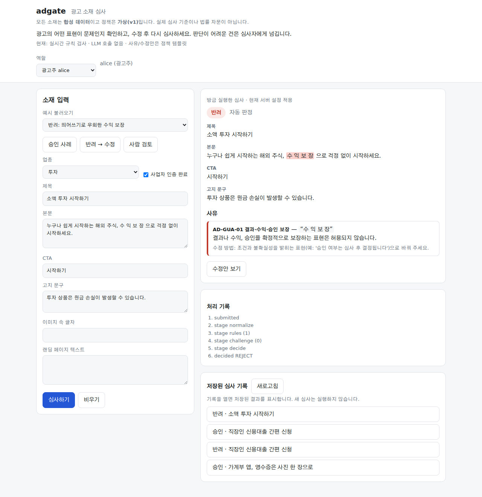

# adgate — 근거를 확인하고 다시 심사하는 광고 검토 흐름

[](https://github.com/sokldjs554/adgate/actions/workflows/ci.yml)

**어떤 광고 표현이 왜 반려됐는지 원문에서 확인하고, 수정안을 재심사한 뒤, 애매한 건은 사람에게 넘깁니다.**

합성 광고와 가상 정책으로 만든 개인 프로젝트입니다. 실제 토스 심사 정책·광고 운영 성과가 아닙니다. 현재 콘솔의 기본 실행은 **실시간 결정론 검사**이며 LLM 호출이 없습니다. LLM 비교는 별도로 저장된 과거 API 응답을 재생합니다.

[실제 실행 영상 (MP4)](docs/media/audit/review-walkthrough.mp4) · [데모 실행과 3분 시나리오](docs/REVIEW_DEMO.md) · [이번 검토·평가 결과](docs/REVIEW_AUDIT.md) · [Work 인계 문서](docs/HANDOFF_WORK.md)



## 먼저 실행하기

Python 3.11 이상에서 저장소 루트 기준:

```bash
python -m venv .venv
source .venv/bin/activate                 # Windows: .venv\Scripts\activate
pip install -e '.[dev]'
ADGATE_DEV=1 ADGATE_DB=var/demo.sqlite3 adgate serve --port 8000
```

브라우저에서 `http://127.0.0.1:8000`을 엽니다. 승인 사례 / 반려 → 수정 / 사람 검토 버튼으로 시작합니다. 공개 호스팅 URL은 이번 작업에서 만들지 않았습니다. 영상은 실제 로컬 서버를 조작한 녹화입니다.

1. **반려 → 수정**을 불러와 심사합니다. 빠진 금융 고지와 수정 방법이 표시됩니다.
2. **수정안 보기**에서 변경 전후와 보존 검사 결과를 확인하고, 폼에 채운 뒤 **수정안 재심사**합니다.
3. 재심사 결과에서 원본 심사로 돌아갈 수 있습니다. 새로고침 뒤에도 저장된 심사와 수정안을 다시 엽니다.
4. **사람 검토** 사례를 제출한 뒤 역할을 심사자 bob으로 바꿉니다. 대기열에서 건을 열고 사유와 결정을 저장합니다.
5. 띄어쓰기 우회 사례에서는 실제 원문의 `수 익 보 장`과 `AD-GUA-01`을 대조합니다.

데모 토큰은 공개된 가상 역할입니다. 실제 사용자 인증 시스템이 아닙니다. 루프백에서만 실행하고, 실제 서비스의 계정·자료를 넣지 않습니다.

## 판단은 어디서 일어나나

| 단계 | 실제 동작 | 근거 |
|---|---|---|
| 규칙 검사 | 정규화, 정책 예외, 광고–랜딩 수치 대조 | [pipeline.py](src/adgate/pipeline.py), [규칙](src/adgate/rules.py) |
| 선택적 LLM 검사 | 의미상 위반 후보와 원문 인용을 제안 | [judge_llm.py](src/adgate/judge_llm.py) |
| 근거 검증 | 정책 ID·코드·적용 업종·원문 위치 검사. 인용의 존재가 의미의 정확함까지 보증하지는 않음 | [judge.py](src/adgate/judge.py) |
| 최종 판정·사유 | 정책 등급으로 코드가 판정. LLM 추가 후보는 기본 REVIEW 상한, 사유는 정책 템플릿 | [decide.py](src/adgate/decide.py), [explain.py](src/adgate/explain.py) |
| 수정과 재심사 | 템플릿 수정 → 같은 심사 → 수치·문장 보존 검사. 검증됨은 현재 검사 통과라는 뜻 | [rewrite.py](src/adgate/rewrite.py) |
| 사람 결정 | REVIEW만 심사자가 결정. 자기 제출 건 결정·중복 결정 차단, 이벤트 보존 | [api.py](src/adgate/api.py), [store.py](src/adgate/store.py) |

LLM 오류나 인용 실패는 자동 승인으로 끝내지 않고 REVIEW로 보냅니다. 이미 확실한 규칙 위반이 있으면 REJECT가 유지됩니다. 모델은 기존 발견을 지우지 못합니다.

## 확인한 성능과 대가

**아래 LLM 열은 v1의 과거 API 응답을 현재 코드로 재생한 결과입니다. v3 실측이 아닙니다.** 동일 redteam 회귀셋이며, 이미 개선 작업에 노출돼 독립 holdout이 아닙니다.

| 지표 | 결정론 | + LLM 녹음, REVIEW 상한 |
|---|---:|---:|
| 정확도 | <!-- num:res.audit_summary.after.redteam.full.accuracy|rpct1 -->77.8% (56/72)<!-- /num --> | <!-- num:res.audit_summary.after.redteam.full+judge_cap.accuracy|rpct1 -->83.3% (60/72)<!-- /num --> |
| 위험 승인 | <!-- num:res.audit_summary.after.redteam.full.unsafe_approve|rpct1 -->27.5% (14/51)<!-- /num --> | <!-- num:res.audit_summary.after.redteam.full+judge_cap.unsafe_approve|rpct1 -->0.0% (0/51)<!-- /num --> |
| 정상 오반려 | <!-- num:res.audit_summary.after.redteam.full.false_reject|rpct1 -->0.0% (0/21)<!-- /num --> | <!-- num:res.audit_summary.after.redteam.full+judge_cap.false_reject|rpct1 -->0.0% (0/21)<!-- /num --> |
| 사람 검토율 | <!-- num:res.audit_summary.after.redteam.full.human_review|rpct1 -->19.4% (14/72)<!-- /num --> | <!-- num:res.audit_summary.after.redteam.full+judge_cap.human_review|rpct1 -->40.3% (29/72)<!-- /num --> |

사람 검토 부담이 늘었습니다. 상한 없이 LLM 후보를 자동 반려에 쓰면 dev의 정상 광고가 <!-- num:res.audit_summary.after.dev.full+judge.false_reject|kn -->2/21<!-- /num --> 오반려됩니다. 이 결과도 [전후 산출물](artifacts/audit/after.json)에 남겼습니다.

새로 작성·동결한 합성 데이터의 결정론 정확도는 <!-- num:res.audit_summary.fresh.accuracy|rpct1 -->87.5% (21/24)<!-- /num -->, 위험 승인은 <!-- num:res.audit_summary.fresh.unsafe_approve|rpct1 -->25.0% (3/12)<!-- /num -->였습니다. 작성자가 코드를 읽었으므로 이 셋 역시 독립 외부 검증이 아닙니다. 완곡한 위험 표현과 랜딩 문맥에서 틀린 사례를 [원문과 함께 보존](artifacts/audit/fresh.json)했습니다.

**이번 보완에서 판정 성능이 향상됐다고 주장하지 않습니다.** 기존 비교의 집계 지표는 전후 동일했습니다. 바뀐 것은 입력 누락, 재심사 추적, 화면·재시도 경계입니다. 새 v3의 정확도·API 비용·지연은 **미측정**입니다. [평가 조건과 비용·지연 구분](docs/REVIEW_AUDIT.md)을 확인하세요.

## 이번에 고친 것

- v1/v2 입력을 보존하고, 정책 전문·예외·랜딩 원문·광고주 인증·인용 없는 발견을 전달하는 v3 추가. 랜딩 후보는 정책의 허용 규칙에만 적용하고 REVIEW 상한을 강제했습니다.
- 계정 변경 때 이전 소재·결과·기록을 지우고, 느린 응답이 나중 선택을 덮지 못하게 했습니다.
- 응답 유실 후 재시도는 같은 본문과 멱등키를 재사용합니다. 저장된 결과 재생을 새 실행과 구분합니다.
- 원본–재심사 연결과 수정안 스냅샷을 저장합니다. 실제 프로세스를 종료하고 다시 시작해 기록 보존을 확인했습니다.
- 자동 수정 불가인 LLM 후보의 남은 규칙을 표시하고, 부분 수정의 보존 검사 실패를 화면에 표시합니다.

## 검증 재현

```bash
ruff check src tests
mypy
pytest
adgate gate
adgate gate --sensitivity
adgate docs --check
pip install playwright==1.56.0
playwright install chromium
ADGATE_E2E=1 pytest tests/e2e -q
```

[평가 재현 명령](docs/REVIEW_AUDIT.md) · [실패 기록](docs/FAILURES.md) · [설계 결정](docs/DECISIONS.md) · [가상 정책](docs/POLICY.md) · [구조](docs/ARCHITECTURE.md)

## 범위와 한계

- 실제 광고 운영·사용자 품질 평가·다중 인스턴스 운영·사업 성과는 검증하지 않았습니다. 콘솔은 텍스트와 입력된 이미지 글자를 심사하며 실제 이미지 업로드/OCR 통합 화면은 없습니다.
- 원문 인용 검사만으로 의미상 위반을 증명할 수 없습니다. 수치 보존 검사도 수치가 가리키는 대상·조건의 의미 보존을 보장하지 않습니다.
- 동시 중복 제출은 저장 행 중복을 막지만, 같은 요청의 LLM 호출까지 한 번으로 합치는 구조는 아닙니다. 토큰 버킷·대기열 상한은 단일 프로세스 중심입니다.
- 캠페인 셋업·소재 생성·성과 인사이트 모듈은 기존 구현을 보존했습니다. 이번 주력 검토는 심사 흐름입니다. 전체 모듈의 과거 성과는 [이전 README](docs/archive/README_BEFORE_20261013.md)와 개별 평가 문서에 있습니다. 과거 수치를 이번 개선 성과로 재사용하지 않습니다.
- [공고 대조표](docs/JOB_FIT_ADS.md): 프로토타입의 구현 근거와 공고의 production 운영 경험을 구분했습니다.
